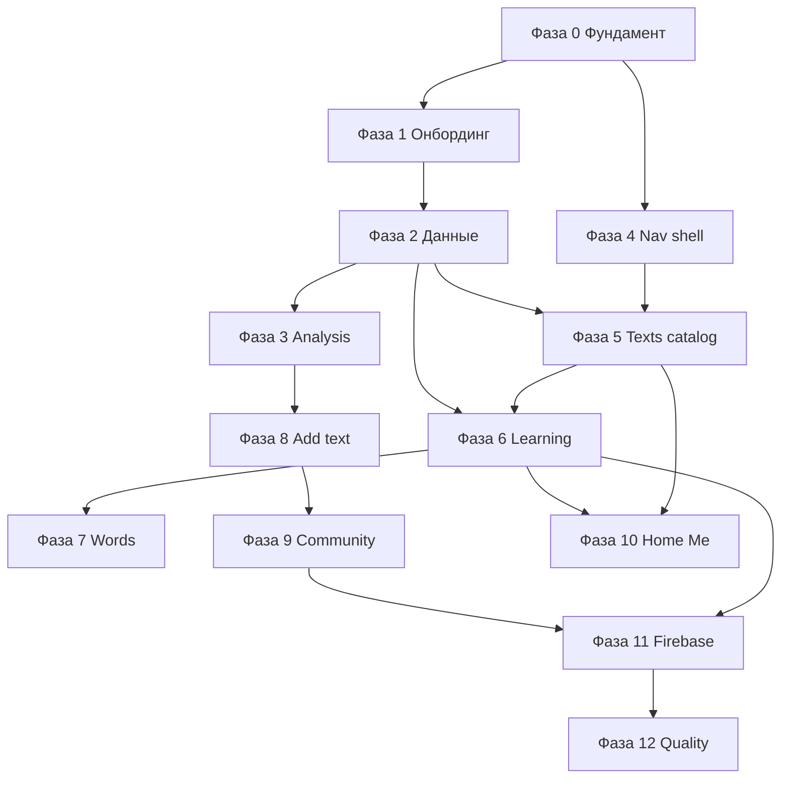

# LingLink — пошаговый план разработки

Документ составлен по спецификации [`instruction.md`](./instruction.md) и модели данных [`dbTypes.ts`](./dbTypes.ts).

**Текущее состояние проекта:** Vue 3 + Vite + Pinia + Vue Router + Firebase в `linglink/`; **MVP-2 локально** (add → analyze → confirm draft → translation → publish); фаза 9 community — далее.

**Ограничения на текущий этап:**

- Только браузер (Capacitor — позже).
- Firebase — целевая БД; на ранних этапах допустим in-memory / LocalStorage / эмулятор с тем же API.
- Стиль UI: **8/16-bit** (пиксельная эстетика, ограниченная палитра, чёткие границы).
- Философия продукта: минимум геймификации; цикл **тексты ↔ слова ↔ чтение**.

**Три независимые доменные стадии (не смешивать в одном «богом-модуле»):**

| Стадия          | Вопрос         | Ключевые модули                                       |
| --------------- | -------------- | ----------------------------------------------------- |
| **Analysis**    | Что в тексте?  | normalize, tokenize, word/root/construction analyzers |
| **Translation** | Как перевести? | proposals, votes, community progress                  |
| **Learning**    | Как учить?     | batches по 5 слов, рендер смешанного текста, progress |

**Capacitor:** только после web MVP (отдельный эпик в фазе 12), браузер — первый клиент.

---

## Архитектурные решения (зафиксировано)

Сводка решений из ревью плана; детали типов — в [`dbTypes.ts`](./dbTypes.ts).

### Языки: forward и reverse (уточнение 2026-09-27)

Полная модель: **[docs/product-language-model.md](docs/product-language-model.md)**.

- **L_known** (часто = язык UI, напр. русский) и **L_learn** (из онбординга, напр. японский).
- Поле **Language** в Add text = язык **оригинала** (`LearningText.language`).

**Forward:** текст на L_known (напр. русские авторы) → translation phase создаёт gloss/proposals на **L_learn** → при чтении неизвестное остаётся на русском, выученное показывается на японском.

**Reverse scaffold:** оригинал на L_learn (текст японца) → для новичка тяжело; если есть **`finalTranslations[L_known]`** (перевод ja→ru), читаем **реверсивно**: каркас — русский из final по `sourceOccurrenceIds`, выученные слова — японский оригинал.

Translation target **не всегда L_learn**: для ja-оригинала переводим в L_known; для ru-оригинала — в L_learn (`translationTargetLanguage` в коде).

### `TextWordOccurrence` — перевод **на месте вхождения**

Одно и то же слово в тексте может переводиться по-разному в разных предложениях. Каждое вхождение хранит **свои** proposals:

```ts
interface TextWordOccurrence {
  id: ID;
  sentenceId: ID;
  position: number;
  wordId?: ID;           // нет, пока слово не создано в базе
  text: string;
  occurrenceCount: number;
  translations: WordTranslationProposal[];
  selectedTranslationId?: ID;
}
```

При рендере чтения выбирается `selectedTranslationId` **конкретного occurrence**, не «один перевод на всё слово в тексте».

### Unknown tokens — **не** создавать `Word` автоматически

После анализа: `wordId` пустой, есть только `text`. `Word` создаётся, когда пользователь/community **вводит перевод** → proposal → привязка `wordId` к occurrence. Отдельная сущность `UnknownWord` для MVP **не нужна**.

### Анализ конструкций — только через найденные `Word`

**Правило:** `constructionAnalyzer` **не** перебирает все `GrammarConstruction` по всему тексту.

```text
token → Word (lookup)
          ├── rootWords (только пересечение с текстом)
          └── grammarConstructions → для каждой: match forms[] по token sequence у якоря
          checkedConstructions: Set<ID> — каждую конструкцию один раз
```

### `GrammarConstruction.forms` — обязательно

Массив поверхностных форм для matcher (например 気をつける / 気をつけて / …). MVP: match последовательности токенов; сложные шаблоны (`〜わけではない`) — позже.

### Поиск по каталогу

На `LearningText`: denormalized `wordIds[]`, `constructionIds[]`.

```text
«行く» → resolve Word #123 → texts where wordIds array-contains #123
«〜わけではない» → GrammarConstruction #456 → constructionIds array-contains #456
```

Плюс поиск по title (substring).

### Уровень текста (`TextLevel`)

Универсальный, **не** привязан к JLPT: `beginner | intermediate | advanced | native` (4 уровня). Поле на `LearningText`, фильтр в Texts.

### Серии (`TextSeries`)

Одна история — несколько глав: `TextSeries` + на тексте `seriesId?`, `seriesPosition?`. UI простой (список глав), без усложнения MVP-1.

### Mastery слова: `UserWordTextHistory` + `UserWordProgress.level` 0–5

- **MVP UI:** только 0 / 1 (не знаю / знаю).
- **Схема:** `level` 0–5; рост **только за разные тексты**, не за 5 проходов одного.
- Запись `UserWordTextHistory { userId, wordId, textId, learnedAt }`, уникальность `userId+wordId+textId`.
- «5/5 Mastered» = 5 **разных** `textId` в history → level 5; сброс «не запомнил» — уменьшить level / удалить записи (правила в фазе 7).

**Не** выводить mastery только из `UserTextProgress` — это прогресс **по одному тексту**.

### Final translation и mapping

`FinalTranslationWord.sourceOccurrenceIds` связывает слово в **естественном** переводе с **дословными** `TextWordOccurrence.id`. Learning-вид и Natural могут расходиться по структуре; additional words в natural — `sourceOccurrenceIds: []`.

### Reports (без moderation panel в MVP)

```ts
Report { id, targetType, targetId, userId, reason, createdAt }
```

Жалобы на текст, слово, конструкцию, перевод, контент. Цепочка после MVP: Report → moderation → `status: hidden`. Suggest correction остаётся для **переводов**; Report — шире.

### Чеклист дополнений к плану

- [x] TextSeries / главы (типы + фазы 2, 5)
- [x] Report (тип + фаза 9, применение hidden — post-MVP)
- [x] UserWordTextHistory (тип + фазы 6–7)
- [x] Occurrence → translation proposals (явно)
- [x] Unknown: не auto-create Word (фаза 8)
- [x] Construction analyzer через `Word.grammarConstructions`
- [x] `level` на тексте
- [x] Поиск wordIds / constructionIds
- [x] FinalTranslation → sourceOccurrenceIds (фаза 9)

---

## Содержание

1. [Фаза 0 — Фундамент](#фаза-0--фундамент)
2. [Фаза 1 — Онбординг и авторизация](#фаза-1--онбординг-и-авторизация)
3. [Фаза 2 — Слой данных и типы](#фаза-2--слой-данных-и-типы)
4. [Фаза 3 — Pipeline анализа текста](#фаза-3--pipeline-анализа-текста)
5. [Фаза 4 — Навигация и каркас экранов](#фаза-4--навигация-и-каркас-экранов)
6. [Фаза 5 — Каталог Texts, поиск и фильтры](#фаза-5--каталог-texts-поиск-и-фильтры)
7. [Фаза 6 — Ядро обучения (Reading)](#фаза-6--ядро-обучения-reading)
8. [Фаза 7 — Раздел Words](#фаза-7--раздел-words)
9. [Фаза 8 — Добавление текста и Translation Phase](#фаза-8--добавление-текста-и-translation-phase)
10. [Фаза 9 — Community-перевод и рейтинги](#фаза-9--community-перевод-и-рейтинги)
11. [Фаза 10 — Home, Me, настройки](#фаза-10--home-me-настройки)
12. [Фаза 11 — Firebase production](#фаза-11--firebase-production)
13. [Фаза 12 — Качество, тесты, подготовка к Capacitor](#фаза-12--качество-тесты-подготовка-к-capacitor)
14. [MVP и порядок релизов](#mvp-и-порядок-релизов)
15. [Зависимости между фазами](#зависимости-между-фазами)
16. [Архитектурные решения (зафиксировано)](#архитектурные-решения-зафиксировано)

---

## Фаза 0 — Фундамент

**Цель:** единая структура кода, дизайн-система 8/16-bit, i18n каркас, перенос типов БД.

### Шаг 0.1 — Структура каталогов

Рекомендуемая схема в `linglink/src/`:

```text
src/
├── assets/           # спрайты, шрифты (pixel font)
├── components/
│   ├── ui/           # кнопки, карточки, прогресс-бары, чекбоксы
│   └── layout/       # AppShell, BottomNav, TopBar
├── composables/
├── domain/           # чистая логика без Vue/Firebase
│   ├── text/         # analysis pipeline
│   ├── learning/     # batching, render mixed text
│   └── translation/
├── services/         # репозитории: words, texts, users
├── stores/           # Pinia
├── views/            # страницы по маршрутам
├── router/
├── i18n/
├── styles/           # CSS variables, pixel theme
└── types/            # re-export / sync с dbTypes.ts
```

**Задачи:**

- [x] Скопировать или symlink `dbTypes.ts` в `src/types/db.ts` (или импорт из корня монорепо).
- [x] Добавить `LanguageCode`, константы языков (UI + learning).
- [x] Настроить alias `@/` в Vite.

### Шаг 0.2 — 8/16-bit UI kit (минимум)

**Задачи:**

- [x] Подключить pixel-шрифт (например Press Start 2P).
- [x] CSS-переменные: фон, акцент, border 2–4px, без blur/gradient (или очень умеренно).
- [x] Компоненты: `PixelButton`, `PixelCard`, `PixelProgressBar`, `PixelCheckbox`, `PixelInput`, `PixelSelect`.
- [x] Mobile-first layout (max-width контейнер, safe-area для будущего Capacitor).

### Шаг 0.3 — i18n

**Задачи:**

- [x] Выбрать `vue-i18n` (или лёгкую обёртку).
- [x] Локали MVP: `ru`, `en`, `ja` (остальные — заглушки в списке).
- [x] Ключи для онбординга, навигации, общих действий.

### Шаг 0.4 — Инструменты качества

**Задачи:**

- [x] Убедиться, что `npm run type-check`, `lint`, `test:unit` проходят в CI (локально достаточно скриптов из package.json).
- [x] Политика: domain-слой покрывать unit-тестами (Vitest), UI — по необходимости.

**Критерий готовности фазы:** пустой `AppShell` с bottom nav-заглушками и одной demo-карточкой в pixel-стиле.

---

## Фаза 1 — Онбординг и авторизация

**Цель:** первый запуск → язык UI → язык изучения → вход → главный экран.

### Шаг 1.1 — Маршруты и guard

**Маршруты:**

| Путь                            | Экран                                |
| ------------------------------- | ------------------------------------ |
| `/welcome`                      | Приветствие LingLink                 |
| `/onboarding/ui-language`       | Выбор языка интерфейса               |
| `/onboarding/learning-language` | Один активный изучаемый язык         |
| `/auth`                         | Continue with Google / Apple / email |
| `/`                             | Home (после онбординга)              |

**Задачи:**

- [x] Pinia store `useSessionStore`: флаги `onboardingComplete`, `activeLearningLanguage`, `interfaceLanguage`.
- [x] Router guard: незавершённый онбординг → редирект на welcome/onboarding.
- [x] Сохранение черновика онбординга в `localStorage` до появления Firebase.

### Шаг 1.2 — Экраны онбординга

**Задачи:**

- [x] Welcome: логотип, слоган, `[ Continue ]`.
- [x] UI language: список с флагами.
- [x] Learning language: один выбор (radio), сохранить в store.

### Шаг 1.3 — Авторизация (интерфейс + заглушка)

**Задачи:**

- [x] UI «максимально незаметный»: одна primary-кнопка Google, вторичные Apple / email.
- [x] До Firebase: mock-user `{ id, displayName }` после клика «Continue».
- [x] После успеха — переход на `/` и запись `User` (mock) с `interfaceLanguage`, `learningLanguages: [one]`.

**Критерий готовности:** новый пользователь проходит цепочку welcome → языки → mock auth → Home-заглушка.

---

## Фаза 2 — Слой данных и типы

**Цель:** абстракция репозиториев, совместимая с Firestore-коллекциями из `dbTypes.ts`.

### Шаг 2.1 — Физическая схема Firestore (зафиксировать в коде)

Логическая модель — в типах; физически (из комментария в `dbTypes.ts`):

```text
texts/{textId}
texts/{textId}/sentences/{sentenceId}
users/{userId}
users/{userId}/wordProgress/{wordId}
users/{userId}/textProgress/{textId}
words/{wordId}
grammarConstructions/{constructionId}
topics/{topicId}
textRatings/{ratingId}
translationVotes/{voteId}
textContributors/{id}
textSeries/{seriesId}
reports/{reportId}
users/{userId}/wordTextHistory/{compositeId}
```

**Задачи:**

- [x] Синхронизировать типы с `dbTypes.ts`: `TextLevel`, `TextSeries`, `UserWordTextHistory`, `Report`, `forms`, `wordIds`/`constructionIds`, `TextWordOccurrence.id`/`sentenceId`.
- [x] Документ `docs/firestore-schema.md` (кратко) или комментарий в `services/firebase/collections.ts`.
- [x] Интерфейсы репозиториев: `WordRepository`, `TextRepository`, `UserRepository`, `ProgressRepository`, `TopicRepository`, `SeriesRepository`, `ReportRepository` (Report — запись только, модерация позже).

### Шаг 2.2 — Mock-реализация

**Задачи:**

- [x] In-memory store + опционально persist в IndexedDB/localStorage.
- [x] Seed-данные: 2–3 `LearningText`, набор `Word`, `Topic`, прогресс для demo-user.
- [x] Единая фабрика `createRepositories(mode: 'mock' | 'firebase')`.

### Шаг 2.3 — Индексы для поиска (заложить в дизайн)

- [x] На `LearningText`: `wordIds`, `constructionIds`, `topics`, `language`, `level`, `translationProgress`, `seriesId?`, рейтинги.
- [x] При publish / обновлении перевода — пересчёт `wordIds`, `constructionIds`, `translationProgress`.
- [x] Поиск: resolve строки → `Word` / `GrammarConstruction` → `array-contains` по id; title — substring.
- [x] `UserWordTextHistory` repository: insert при завершении обучения слова в тексте; count distinct `textId` для mastery.

**Критерий готовности:** composable `useTexts()` возвращает seed-каталог; `useWordProgress()` читает/пишет `level` (MVP: 0|1, тип допускает 0–5).

---

## Фаза 3 — Pipeline анализа текста

**Цель:** реализовать **Analysis** без AI; один проход → индексы → preview → только после confirm — save.

### Шаг 3.1 — Модули domain/text (как в instruction.md)

| Файл                      | Ответственность                                                        |
| ------------------------- | ---------------------------------------------------------------------- |
| `normalizeText.ts`        | NFC, `\r\n`, пробелы; `original` + `normalized`                        |
| `sentenceSplitter.ts`     | `SentenceDraft[]` с id, position                                       |
| `tokenizer.ts`            | `Token` word \| punctuation \| number \| other                         |
| `buildTextIndexes.ts`     | `Map<normalized, Token[]>`, `Set` уникальных                           |
| `wordAnalyzer.ts`         | lookup Word в repo, occurrence counts                                  |
| `rootWordAnalyzer.ts`     | rootWords ∩ слова текста; `checkedRootWords` Set                       |
| `constructionAnalyzer.ts` | **только** `word.grammarConstructions` у уже найденных `Word`; forms[]; token sequence; `checkedConstructions` Set |
| `textStatistics.ts`       | `TextAnalysisStatistics`                                               |
| `textAnalysisService.ts`  | оркестрация → `TextAnalysisResult`                                     |

**Задачи:**

- [x] Типы draft/analysis: `TextAnalysisResult`, `AnalyzedWord`, `AnalyzedConstruction` (локально или в `types/analysis.ts`).
- [x] Unit-тесты на русском и японском коротких примерах из instruction.
- [x] MVP matcher конструкций: последовательность токенов; сложные шаблоны (`〜わけではない`) — отложить.

### Шаг 3.2 — GrammarConstruction.forms

**Задачи:**

- [x] Поле `forms: string[]` в `dbTypes.ts` (обязательно).
- [x] `constructionAnalyzer` **не** сканирует глобальный список конструкций — только цепочка token → Word → `grammarConstructions`.
- [ ] При сохранении/редактировании конструкции из UI — заполнять `forms` (фаза 8 UI).

### Шаг 3.3 — Preview без записи в БД

**Задачи:**

- [x] Composable `useTextAnalysis()` держит результат в памяти до Confirm.
- [x] UI preview: статистика, подсветка known/unknown слов (CSS классы).

**Критерий готовности:** из строки текста получаем statistics + список unique words + constructions; тесты green.

---

## Фаза 4 — Навигация и каркас экранов

**Цель:** 4 раздела bottom nav: **Home | Texts | Words | Me**.

### Шаг 4.1 — Layout

**Задачи:**

- [x] `AppLayout`: top bar (заголовок, опционально 🔍), `<router-view>`, `BottomNav` (4 таба).
- [x] Активный изучаемый язык — подзаголовок на Home/Texts.

### Шаг 4.2 — Заглушки views

**Задачи:**

- [x] `HomeView`, `TextsView`, `WordsView`, `MeView` — подключены к router.
- [x] Глобальный поиск: entry point из иконки 🔍 (маршрут `/search` modal или full screen).

**Критерий готовности:** переключение табов без перезагрузки; deep link на `/texts/:id` зарезервирован.

---

## Фаза 5 — Каталог Texts, поиск и фильтры

**Цель:** «сердце» каталога — карточки, два прогресса, фильтры, поиск по словам.

### Шаг 5.1 — Список текстов

**Задачи:**

- [x] `TextCard`: image, title, language, duration estimate, topics, **Translation** (community `translationProgress`), **Your progress** (`UserTextProgress.progress`).
- [x] `TextsView`: секция заголовка, фильтры.

### Шаг 5.2 — Фильтры MVP

| Фильтр      | Значения                                                                                                   |
| ----------- | ---------------------------------------------------------------------------------------------------------- |
| Level       | `TextLevel`: beginner, intermediate, advanced, native (поле `LearningText.level`, без JLPT)   |
| Topic       | из `Topic`                                                                                                 |
| Progress    | All / Not started / In progress / Completed                                                                |
| Known words | 0–25% … 75–100% (вычислять: known unique / total unique в тексте)                                          |

**Задачи:**

- [x] Composable `useTextFilters()` — чистые функции фильтрации + store query params в URL.

### Шаг 5.3 — Поиск

**Задачи:**

- [x] Поиск по title (substring).
- [x] Слово: строка → lookup `Word` → `LearningText.wordIds` contains `word.id`.
- [x] Конструкция: строка → lookup `GrammarConstruction` → `constructionIds` contains `construction.id`.
- [x] UI: блок «Texts containing: …».
- [ ] (MVP-2+) Серия: карточка серии → список глав по `seriesPosition`; один текст может быть без серии.

### Шаг 5.4 — Экран превью текста (до START)

**Задачи:**

- [x] `TextPreviewView`: title, meta, sentence count, unique words, translation %, author + contributors count.
- [x] Кнопки: `[ START ]`, ссылка на contributors (contributors — счётчик; отдельный экран позже).

**Критерий готовности:** из Texts открывается preview; фильтры и поиск работают на seed-данных.

---

## Фаза 6 — Ядро обучения (Reading)

**Цель:** механика «5 слов → чтение → следующие 5» и постепенная подмена языка в тексте.

### Шаг 6.1 — Prepare (⚙)

**Задачи:**

- [x] `TextPrepareView`: список слов текста с чекбоксами «уже знаю».
- [x] Группы root words: UI блок «Related words» + «Know all».
- [x] Отдельная секция **Grammar constructions** (цельная конструкция, не разбивать).
- [x] Actions: **Know all**, сохранить в `UserWordProgress` (level=1) и в локальный snapshot для сессии текста.
- [x] Инициализация `UserTextProgress`: `learnedWordIds`, `learnedConstructionIds`, `currentStep`, `progress`.

### Шаг 6.2 — Выбор batch из 5 слов

**Алгоритм:**

1. Исключить слова с progress level=1 (known) и отмеченные в Prepare.
2. Из оставшихся взять **5 с наибольшим `occurrenceCount`** в тексте.
3. После прохождения раунда — пометить как learned для этого текста, увеличить `currentStep`.

**Задачи:**

- [x] `domain/learning/selectNextWordBatch.ts` + unit-тests.
- [x] Экран «Next words» перед раундом (список 5).
- [x] После раунда: «Great! 5 words learned» + Continue (сейчас сразу batch/completed).

### Шаг 6.3 — Рендер смешанного текста

**Правила:**

- Known (глобально или в тексте learned): показывать **форма из перевода** (target language word from selected translation).
- Current batch: подсветка / bold на изучаемом языке (instruction: новые в batch учатся в контексте).
- Остальное: язык оригинала текста (native / source language пользователя).

**Задачи:**

- [x] `domain/learning/renderSentence.ts`: на вход sentence + **per-occurrence** selected translation + множества known/batch.
- [x] `ReadingView`: постранично или scroll по предложениям; кнопка «закончить раунд».
- [x] Обновление `UserTextProgress.progress` = learned / total teachable units (слова + конструкции по правилам MVP).

### Шаг 6.4 — Завершение текста

**Задачи:**

- [x] `TextCompletedView`: stats, rate text (заглушка), read again, find another.
- [x] После раунда/текста: upsert `UserWordTextHistory` (уникально user+word+text); обновить `UserWordProgress.level` (MVP: 0→1 при первом learn; позже level = f(distinct texts)).
- [x] Сохранение learned words в `UserWordProgress`.

**Критерий готовности:** один seed-текст проходится от Prepare до 100% progress с визуальным «заполнением» языка.

---

## Фаза 7 — Раздел Words

**Цель:** словарь пользователя, mastery через тексты, переход word → texts.

### Шаг 7.1 — Список

**Задачи:**

- [x] Табы/фильтры: All, Learning, Known, Unknown (MVP: level 0 vs 1).
- [x] Поиск по substring word.
- [x] Прогресс-бар «N/5»: `count(distinct textId)` из `UserWordTextHistory` для пары user+word; level 5 при N≥5 (после MVP — шаги 1–5); MVP может показывать только Known/Unknown.
- [x] Действие «I forgot» / сброс mastery — post-MVP или минимальный dec level.

### Шаг 7.2 — Карточка слова

**Задачи:**

- [x] `WordDetailView`: reading/translation (из Word.translations на target lang), список «Known in: [text titles]».
- [x] «Found in N texts» + `[ Read texts ]` → поиск/фильтр Texts по wordId.

**Критерий готовности:** из Words открывается слово и возврат в каталог с фильтром по word.

---

## Фаза 8 — Добавление текста и Translation Phase

**Цель:** пользовательский путь Add text → Analyze → Preview → Confirm → Translate → Publish.

### Шаг 8.1 — Форма Add text

**Поля:** title, **language = язык вставленного текста (source)**, `level`, topics, image, body; опционально `seriesId` + position при главе.

**Задачи:**

- [x] `AddTextView` + валидация.
- [x] Кнопка «Analyze» → Phase 3 pipeline.

### Шаг 8.2 — Confirm и создание сущностей

После Confirm:

- [x] **Не** создавать `Word` для unknown — только `TextWordOccurrence` с `wordId?` undefined, `id`, `sentenceId`, `text`, proposals [].
- [x] `createLearningText()`: meta + `wordIds`/`constructionIds` (известные id на момент save), sentences subcollection / embedded для mock.
- [x] Каждое вхождение — отдельный `TextWordOccurrence` (переводы на уровне occurrence).
- [x] `ConstructionOccurrence` где найдено.
- [x] `Word` создаётся в Translation phase при первом переводе unknown → proposal → set `wordId`.
- [x] `status: draft` до Publish.

### Шаг 8.3 — Translation Phase UI

**Задачи:**

- [x] Группировка unique words (не дублировать «пошел ×2» в списке полей).
- [x] Для каждого **уникального** слова в UI группировки; при сохранении — proposals на **occurrences** (если переводы различаются по контексту — разные selectedTranslationId).
- [x] Unknown: ввод перевода → create target-lang `Word` → proposal → link `wordId` на occurrences.
- [ ] UI однокоренных и конструкций (как в instruction §22–24) — post-MVP в translation UI.
- [x] Пересчёт `translationProgress` на тексте.
- [x] `[ Publish ]` → `status: published`.

**Критерий готовности:** добавленный пользователем текст появляется в Texts после publish; analysis не пишет в БД до confirm.

---

## Фаза 9 — Community-перевод и рейтинги

**Цель:** доработка перевода на странице текста, голоса, финальный natural translation.

### Шаг 9.1 — Translation tab на тексте

**Задачи:**

- [x] Прогресс-bar community translation, список «Words needing translation».
- [x] Modal: выбор proposal / add another → `WordTranslationProposal`.

### Шаг 9.2 — Голосование

**Задачи:**

- [x] 👍/👎 обновляет `TranslationVotes`; учёт `TranslationVote` per user (one vote).
- [x] `Suggest correction` flow (новый proposal + reason).

### Шаг 9.3 — Final / Natural translation

**Задачи:**

- [x] Вкладки Learning vs Natural; `FinalTranslation` + `FinalTranslationWord` с **`sourceOccurrenceIds`** (связь natural ↔ дословные вхождения).
- [x] Highlight «Additional words» в natural (`wordId?` + пустые `sourceOccurrenceIds`).
- [ ] Опционально добавлять extra words в learning pool.

### Шаг 9.5 — Report (MVP-minimal)

**Задачи:**

- [x] UI «Report» на тексте / переводе / слове (форма reason + targetType + targetId).
- [x] Запись `Report` в repo; **без** admin panel в MVP.
- [ ] Post-MVP: очередь жалоб → manual `LearningText.status = hidden`.

### Шаг 9.4 — Рейтинг текста после прохождения

**Задачи:**

- [x] `TextRating`: usefulness, interestingness (+ uniqueness, learningValue позже).
- [x] Агрегация в `LearningText.ratings`.

**Критерий готовности:** второй пользователь (mock) может добавить proposal и прогolosовать; рейтинг сохраняется.

---

## Фаза 10 — Home, Me, настройки

### Шаг 10.1 — Home

**Задачи:**

- [x] «Continue learning» — последний `UserTextProgress` in progress.
- [x] Recommended — простая эвристика MVP: высокий translationProgress, мало user progress, совпадение topic.

### Шаг 10.2 — Me

**Задачи:**

- [x] Профиль: имя, active learning language, stats (words count, texts completed, contributions).
- [x] Пункты: My texts, Saved texts (favorites — поле/user subcollection), My contributions, Settings, About.
- [x] `＋ Add text` → Phase 8 (заглушка `/add-text`).

### Шаг 10.3 — Settings

**Задачи:**

- [x] Смена UI language, смена learning language (один active).
- [x] Logout (Firebase позже).

**Критерий готовности:** Home показывает continue card; Me ведёт на add text и settings.

---

## Фаза 11 — Firebase production

**Цель:** заменить mock на Firestore + Auth + Storage (картинки текстов).

### Шаг 11.1 — Firebase project

**Задачи:**

- [x] `.env` с config (не коммитить secrets); `initializeApp`, `getFirestore`, `getAuth`, `getStorage`.
- [x] Security rules MVP: пользователь пишет свой progress; тексты published read-all; draft — только author.

### Шаг 11.2 — Auth

**Задачи:**

- [x] Google Sign-In web; Apple/email по приоритету.
- [x] Sync `User` document on first login.

### Шаг 11.3 — Repositories Firebase

**Задачи:**

- [x] Реализации всех репозиториев; batch writes при publish текста.
- [ ] Cloud Function (опционально): пересчёт `translationProgress`, denormalized `wordIds` — или клиентский пересчёт на MVP.

### Шаг 11.4 — Offline

**Задачи:**

- [x] Firestore persistence для чтения текстов offline (ограниченный MVP).

**Критерий готовности:** два браузера под разными аккаунтами видят один published текст и свой progress.

---

## Фаза 12 — Качество, тесты, подготовка к Capacitor

### Шаг 12.1 — Тесты

**Приоритет unit:**

- [x] tokenizer, sentence split, word batch selection, renderSentence, translationProgress calc, filters/search.

### Шаг 12.2 — Performance

**Задачи:**

- [ ] Не грузить все sentences при списке Texts — только meta.
- [ ] Lazy load sentence subcollection на ReadingView.

### Шаг 12.3 — Capacitor (будущее)

**Задачи:**

- [ ] Document viewport, safe-area уже в CSS.
- [ ] План: `@capacitor/core`, splash, status bar, deep links — отдельный эпик после web MVP.

### Шаг 12.4 — Доступность и UX

**Задачи:**

- [ ] Focus states для keyboard; контраст pixel-theme.
- [ ] Loading/error states на всех async экранах.

---

## MVP и порядок релизов

### MVP-1 (локальный demo, без Firebase)

Онбординг (mock auth) → Texts (seed) → Preview → Prepare → Reading (5-word batches) → Words (list + detail) → минимальный Home.

**Не входит:** add text publish, community votes, final translation, Report UI, TextSeries UI, mastery 5/5 (можно только 0/1).

### MVP-2 (полный цикл контента)

Analysis pipeline + Add text + Translation phase + Publish + community proposals + `UserWordTextHistory` + поиск wordIds/constructionIds + level на тексте (без Cloud Functions).

### MVP-3 (online)

Firebase Auth + Firestore + Storage + security rules.

### v1.0

Рейтинги, natural translation + sourceOccurrence mapping, favorites, contributors, TextSeries, Report → hidden, mastery 1–5 по разным текстам, polish 8-bit UI.

---

## Зависимости между фазами



**Рекомендуемый порядок работы для одного разработчика:**

1. F0 → F4 (оболочка видна)
2. F2 + F3 параллельно (данные + анализ)
3. F1 (онбординг)
4. F5 → F6 (главная ценность)
5. F7 → F10
6. F8 → F9
7. F11 → F12

---

## Чеклист соответствия instruction.md

| Раздел instruction                  | Фаза плана |
| ----------------------------------- | ---------- |
| §1 Первый запуск                    | 1          |
| §2 Авторизация                      | 1, 11      |
| §3 Главный экран / 4 таба           | 4, 10      |
| §4–7 Texts, поиск, фильтры, preview | 5          |
| §8–10 Prepare, группы, grammar      | 6          |
| §11–15 Learning batches, completion | 6          |
| §16–17 Words                        | 7          |
| §18–19 Add text                     | 8          |
| Подкапотка analysis §1–26           | 3, 8       |
| Community translation §20–22        | 9          |
| §23 Me                              | 10         |
| Философия UI §24                    | 0, 4, 12   |

---

## Риски и решения

| Риск                                | Митигация                                                                             |
| ----------------------------------- | ------------------------------------------------------------------------------------- |
| Японская токенизация без морфологии | MVP: пробелы + словарь; для ja — optional kuromoji позже, не блокировать MVP на ru/en |
| Размер документа Firestore          | sentences в subcollection; не embed огромные arrays                                   |
| `forms` конструкций неполные        | community дополняет; matcher по token sequence                                        |
| Два прогресса путают пользователя   | чёткие подписи Translation vs Your progress на карточке                               |
| Сложность community voting          | MVP: up/down без reputation; `Report` без panel; hidden — post-MVP                    |
| Мусорные `Word` при анализе         | Не создавать Word до перевода; только occurrence + optional wordId                    |
| Mastery из одного текста            | Только `UserWordTextHistory` distinct textId; не считать повторы одного текста        |

---

## Отложено — продолжить позже (2026-09-27)

Хвосты фаз **3, 5, 8, 9** (и связанный контекст) вынесены в отдельный backlog, чтобы не смешивать с текущими **правками**:

→ **[docs/deferred-backlog.md](docs/deferred-backlog.md)** — таблицы по фазам, причины, рекомендуемый порядок при возобновлении.

Кратко: UI `forms` / rich translation UI; TextSeries + contributors; community extra-words, модерация report, report по word/proposal; опционально JP-шаблоны конструкций.

---

_Документ можно обновлять по мере реализации: отмечать чекбоксы, добавлять ссылки на PR/commиты._
