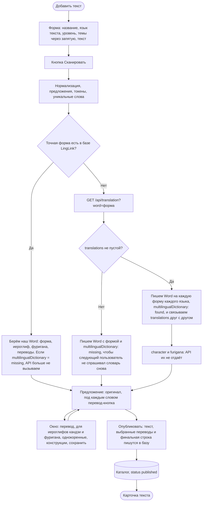

# Добавление текста: схема от кнопки до публикации

Схема сканирования, которая сейчас в форме «Добавить текст». Кнопка называется «Сканировать»: текст режется на предложения и слова, переводы подставляются из базы или словаря Piether, затем пользователь проверяет каждое слово.

Документация API: https://dictionary.piether.com/docs

## Как стучимся в словарь

`GET https://dictionary.piether.com/api/translation?word={слово}`

В документации ещё указан базовый адрес `https://my-multilingual-dictionary.deoliste.workers.dev` и заголовок `Authorization: Bearer <ключ>`. С хоста `dictionary.piether.com` запрос без ключа сейчас тоже отвечает. Какой адрес и нужен ли ключ в приложении — поправить здесь.

Ответ, если слово есть:

```json
{
  "word": "狗",
  "translations": {
    "de": ["Hund"],
    "en": ["dog"],
    "es": ["perro"],
    "fr": ["chien"],
    "ja": ["犬"],
    "ko": ["개"],
    "zh": ["狗"]
  }
}
```

Поиск идёт и по самому слову, и по переводам: `word=hello` возвращает каноническую запись `你好` и все языки. Поля `word` — это не обязательно форма из текста.

Если слова в словаре нет, ответ всё равно `200`, а `translations` пустой:

```json
{ "word": "asdfghqwerty", "translations": {} }
```

Фуриганы и пиньиня в ответе нет. Для иероглифов у нас в `Word` есть `character` и `furigana`, но API их не присылает.

## Блоксхема



## Что поправить перед реализацией

- Адрес API и нужен ли Bearer-ключ в приложении.
- Куда класть `character` и `furigana`, если словарь их не присылает.
- Что считать целевым языком на превью: язык изучения пользователя или что-то другое.
- Каноническое `word` в ответе часто на другом языке, чем слово в тексте. В базу пишем форму из текста и все переводы, а не только каноническую строку.
- Пустой `translations` создаёт Word только с формой и `multilingualDictionary: missing`. Ошибка сети или ответ не 200 слово не записывает: запрос можно повторить.
